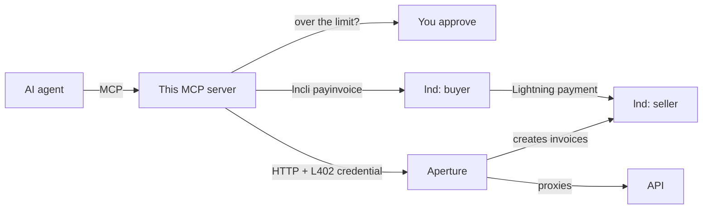

# L402 agent wallet

An MCP server that lets an AI agent pay for HTTP APIs over Lightning, within limits you set.

[L402](https://docs.lightning.engineering/the-lightning-network/l402) is Lightning Labs' protocol for charging for an API. The server answers `402 Payment Required` with a Lightning invoice and a macaroon. The client pays the invoice and sends `L402 <macaroon>:<preimage>` as a reusable credential.

Giving an agent a wallet to do this is risky. It could overspend, pay twice after a network error, or be tricked by a provider. This server sits between the agent and the wallet and decides what gets paid.



## Built on Lightning Labs software

| Component | Version | Role here |
|---|---|---|
| [lnd](https://github.com/lightningnetwork/lnd) | v0.21.3-beta | The buyer and seller Lightning nodes. The agent pays through `lncli` with a macaroon limited to `offchain:read`, `offchain:write`, and `info:read`. |
| [Aperture](https://github.com/lightninglabs/aperture) | v0.5.0 | The seller's L402 reverse proxy. It answers unpaid requests with a 402, an invoice from the seller's lnd, and a macaroon, then checks credentials and proxies paid requests to the API. |
| [Lightning Terminal (litd)](https://github.com/lightninglabs/lightning-terminal) | v0.17.7 | Optional. A litd account caps what its macaroon can spend. lnd enforces it through litd's RPC middleware, even for payments that bypass this server. |
| [Wavelength](https://github.com/lightninglabs/wavelength) | API at `2c4f1ee` | Optional wallet backend that pays from an Ark wallet without running a Lightning node. Not yet tested against a live daemon. |

The rest isn't from Lightning Labs. [btcd](https://github.com/btcsuite/btcd) runs the regtest chain. This project adds the MCP server, the spending policy, the SQLite ledger, the demo seller, and its `/.well-known/l402.json` discovery file. That file is this project's own convention, not part of L402 or Aperture.

## How a payment works

1. The agent calls `l402_fetch` with a URL and the most it's willing to spend (`max_sats`).
2. Aperture replies `402` with an invoice and a macaroon. The server decodes the invoice with lnd and adds the 10-sat maximum routing fee.
3. It checks the limits. Up to the auto-approval amount, it pays without asking. Above that, it asks you to approve. Above `max_sats` or the daily budget, it refuses.
4. Before paying, it reserves the full amount in a local SQLite database. Two agents sharing the database can't both spend the same budget.
5. It pays through lnd with the fee limit, checks that the preimage matches the invoice's payment hash, and records the actual cost. A 30-sat reservation might settle as 23 sats.
6. It retries the request with `L402 <macaroon>:<preimage>`. Aperture verifies it and proxies to the API. Later requests to the same service reuse the credential without paying again.

If lnd's answer is lost (a crash or a timeout), the payment stays reserved and is never resent. The next call looks it up in lnd's payment history instead.

## Try it

Requires [Bun](https://bun.sh) and Go 1.26+. Everything runs on a local Bitcoin test network (regtest) with test coins.

```sh
bun install --frozen-lockfile
bun run build:binaries   # builds lnd, Aperture, and btcd from source into .bin/
bun run up               # starts btcd, two lnd nodes, Aperture, and the demo seller in .demo/
```

Open Claude Code (or another MCP client) in this directory. It picks up the server from [`.mcp.json`](.mcp.json), which auto-approves up to 100 sats with a 5,000-sat daily budget. Then ask it to:

1. Fetch `http://127.0.0.1:8700/v1/hashprice`. It costs 10 sats plus up to 10 in fees, so it's paid without asking.
2. Fetch it again. The saved credential is reused and nothing is paid.
3. Fetch `http://127.0.0.1:8700/v1/report`. At 1,000 sats, it's over the auto-approval limit, so you're asked first. A client that can't show MCP approval prompts gets a refusal instead.
4. Call `l402_wallet` to see the receipts.

Run `bun run down` to stop the network. The demo seller sells fixed test data: hashprice for 10 sats, break-even data for 50, and a report for 1,000.

| Tool | What it does |
|---|---|
| `l402_fetch` | Fetch a URL, paying if needed. Supports GET and POST |
| `l402_discover` | List a provider's services and prices |
| `l402_wallet` | Show today's spending, balance, and recent receipts; resolve pending payments |
| `l402_subscribe` | Approve recurring payments to one service (see below) |
| `l402_subscriptions` | List or cancel subscriptions |

## Configuration

| Variable | Default | Meaning |
|---|---|---|
| `L402_AUTO_APPROVE_SATS` | `100` | Pay without asking up to this amount |
| `L402_DAILY_BUDGET_SATS` | `5000` | Most that can be spent or reserved per UTC day |
| `L402_DEMO_DIR` | `.demo` | Test network directory |
| `L402_STATE_DIR` | `$L402_DEMO_DIR/agent` | Payment database |

All limits include the maximum routing fee. `bun run up` won't overwrite a non-empty `L402_DEMO_DIR`; point it at a new directory instead.

## Subscriptions

`l402_subscribe` asks you once to approve up to a set amount per period, for a fixed number of periods, to one service. After that, the agent renews an expired credential without asking.

- At most one renewal is paid per period, and the daily budget still applies.
- A renewal only happens once the credential has actually expired, so a provider can't trigger extra payments.
- After you cancel, the current credential keeps working until it expires.

On the seller side, set `timeout` (in seconds) and a fixed `price` on the [Aperture](https://github.com/lightninglabs/aperture) service. Aperture v0.5.0 ignores `timeout` for services that use `dynamicprice` or have no `price`, so their credentials never expire. This is [fixed upstream](https://github.com/lightninglabs/aperture/commit/771f371ba5dcd4f11b864b0caa4ae5c233d9cc4a) but not yet released.

## A hard ceiling with litd

These limits live in this app. Anything with direct access to the wallet credentials can bypass them. For a ceiling that can't be bypassed, pay through a [litd](https://github.com/lightninglabs/lightning-terminal) account, which refuses any payment over its balance:

```sh
litcli accounts create <sats> --expiration_date <unix> --save_to <file>

export L402_LND_MACAROON=<file>
export L402_LND_RPCSERVER=127.0.0.1:8443
export L402_LND_TLSCERT="$L402_DEMO_DIR/lit/tls.cert"
```

litd runs in remote mode next to the buyer's lnd, which must start with `--rpcmiddleware.enable` (`L402_RPC_MIDDLEWARE=1 bun run up`). Build litd with `bun run build:litd`; `bun run verify:litd` sets all of this up and checks it. For a subscription, size the account at the per-period amount × the number of periods, and let it expire when the subscription ends.

## Wallets

- **lnd** (default): works only on the local test network.
- **litd account**: as above.
- **Wavelength** (untested with a live wallet): set `L402_WALLET=wavelength`, `WAVELENGTH_URL`, `WAVELENGTH_MACAROON_PATH`, and `WAVELENGTH_TLS_CERT`.

## Testing

```sh
bun test                                  # unit, crash, and concurrency tests
bun run verify:local                      # real payments on a fresh test network
bun run build:litd && bun run verify:litd # litd account limits
```

The test-network checks use fixed ports, so run one at a time.

Not tested: real Bitcoin (mainnet or signet), Wavelength with a live wallet, disk or power loss (process crashes are tested), subscription periods longer than seconds, and a litd account expiring mid-payment.

## Limits

- This is a local tool for one user, not a hosted service.
- Paying doesn't guarantee a useful response.
- Separate state directories don't share a budget.
- Retrying a POST can run the provider's operation twice.
