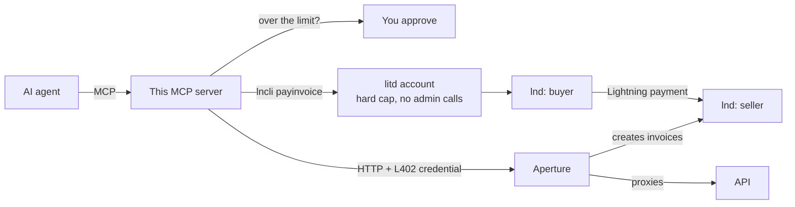

# L402 agent wallet

An MCP server that lets an AI agent pay for HTTP APIs over Lightning, within limits you set.

[L402](https://docs.lightning.engineering/the-lightning-network/l402) is Lightning Labs' protocol for charging for an API. The server answers `402 Payment Required` with a Lightning invoice and a macaroon. The client pays the invoice and sends `L402 <macaroon>:<preimage>` as a reusable credential.

Giving an agent a wallet to do this is risky. It could overspend, pay twice after a network error, or be tricked by a provider. This server sits between the agent and the wallet and decides what gets paid. Underneath, a [litd](https://github.com/lightninglabs/lightning-terminal) account enforces a spending cap inside lnd, so the limit holds even if the agent bypasses this server.



The diagram shows the default lnd demo. The optional Wavelength backend pays Lightning invoices from an Ark wallet through its operator and swap service.

## Built on Lightning Labs software

| Component | Version | Role here |
|---|---|---|
| [lnd](https://github.com/lightningnetwork/lnd) | v0.21.4-beta | The buyer and seller Lightning nodes. The agent pays through `lncli`. The fallback macaroon lists only the four RPCs the wallet calls ([`scripts/agent-permissions.txt`](scripts/agent-permissions.txt)). |
| [Aperture](https://github.com/lightninglabs/aperture) | v0.5.0 | The seller's L402 reverse proxy. It answers unpaid requests with a 402, an invoice from the seller's lnd, and a macaroon, then checks credentials and proxies paid requests to the API. |
| [Lightning Terminal (litd)](https://github.com/lightninglabs/lightning-terminal) | v0.17.7 | The default wallet credential. A litd account caps what its macaroon can spend and refuses node-administration RPCs. lnd enforces it through litd's RPC middleware, even for payments that bypass this server. |
| [Wavelength](https://github.com/lightninglabs/wavelength) | v0.2.0-rc2 | Optional Ark wallet backend. Live signet payment and preimage verification pass; see [docs/wavelength.md](docs/wavelength.md) for setup and the local RC2 acknowledgment fix. |

The rest isn't from Lightning Labs. [btcd](https://github.com/btcsuite/btcd) runs the regtest chain. This project adds the MCP server, the spending policy, the SQLite ledger, the demo seller, and its `/.well-known/l402.json` discovery file. That file is this project's own convention, not part of L402 or Aperture.

## How a payment works

1. The agent calls `l402_fetch` with a URL and the most it's willing to spend (`max_sats`).
2. Aperture replies `402` with an invoice and a macaroon. The selected wallet backend decodes or previews the invoice. The MCP server budgets for its amount plus a fixed 10-sat maximum routing fee.
3. It checks the limits. Up to the auto-approval amount, it pays without asking. Above that, it asks you to approve. Above `max_sats` or the daily budget, it refuses.
4. Before paying, it reserves the full amount in a local SQLite database. Two agents sharing the database can't both spend the same budget.
5. It pays through the selected backend with the fee limit, checks that the preimage matches the invoice's payment hash, and records the actual cost. A 30-sat reservation might settle as 23 sats.
6. It retries the request with `L402 <macaroon>:<preimage>`. Aperture verifies it and proxies to the API. Later requests to the same service reuse the credential without paying again.

The lnd backend uses `lncli`; Wavelength uses `PrepareSend` to obtain a single-use send intent, submits it with `Send`, then polls activity for settlement and a preimage. Wavelength accepts only the Lightning settlement rail for L402, since an in-Ark transfer may not reveal the required preimage.

If the wallet's answer is lost (a crash or a timeout), the payment stays reserved and is not automatically resent. The next `l402_fetch` or `l402_wallet` call checks the backend's payment history. Unknown outcomes keep their reservation; a confirmed failure releases it. A payment reported as settled without a valid preimage is recorded as paid, but cannot produce an L402 credential or trigger automatic repayment.

## A hard ceiling with litd

The MCP spending policy lives in this app, so anything that can read the wallet credential could pay around it. `bun run up` therefore gives the agent a [litd](https://github.com/lightninglabs/lightning-terminal) account macaroon (`.demo/agent-account.macaroon`), not an lnd macaroon. litd runs in remote mode next to the buyer's lnd, which starts with `--rpcmiddleware.enable`, and lnd enforces the account on every call made with it:

- Payments, including fees, cannot exceed the account's remaining allowance (`L402_ACCOUNT_SATS`, default 20,000 sats) or happen after it expires (`L402_ACCOUNT_DAYS`, default 30).
- RPCs outside litd's account allowlist are refused, so the credential cannot delete payment history, change channel policy, intercept HTLCs, or send on-chain.

The MCP policy still decides what is paid automatically, what needs approval, and the daily and task budgets; the account is the ceiling beneath it. `bun run verify:local` checks that both agent credentials are refused node-administration calls, and `bun run verify:litd` checks the allowance with payments that bypass the MCP server. For a subscription, size an account at the per-period amount × the number of periods, and let it expire when the subscription ends:

```sh
litcli accounts create <sats> --expiration_date <unix> --save_to <file>
export L402_LND_MACAROON=<file>
```

## Try it

Requires [Bun](https://bun.sh) and Go 1.26+. The default payment network runs locally on Bitcoin regtest with test coins. The seller fetches public market data unless fixed-data mode is enabled.

```sh
bun install --frozen-lockfile
bun run build:binaries   # builds lnd, Aperture, litd, and btcd from source into .bin/
bun run up               # starts btcd, two lnd nodes, Aperture, the demo seller, and litd in .demo/
```

Open Claude Code (or another MCP client) in this directory. It picks up the server from [`.mcp.json`](.mcp.json), which auto-approves up to 100 sats with a 5,000-sat daily budget. Then ask it to:

1. Fetch `http://127.0.0.1:8700/v1/hashprice`. It costs 10 sats plus up to 10 in fees, so it's paid without asking.
2. Fetch it again. The saved credential is reused and nothing is paid.
3. Fetch `http://127.0.0.1:8700/v1/report`. At 1,000 sats, it's over the auto-approval limit, so you're asked first. A client that can't show MCP approval prompts gets a refusal instead.
4. Call `l402_wallet` to see the receipts.

Run `bun run down` to stop the network. The demo seller offers hashprice for 10 sats, break-even data for 50, and a report for 1,000. It fetches market data from mempool.space, caches it for 60 seconds, and falls back to cached data or the bundled snapshot when unavailable. Responses include the data's `as_of` and `source`; fallback data can be stale. Use `L402_FIXED_MARKET=1 bun run up` for repeatable snapshot data, as the verification scripts do.

The break-even endpoint accepts `j_per_th` (miner efficiency, default `17.5`) and `usd_per_kwh` (power price, default `0.05`), for example `/v1/breakeven?j_per_th=21.5&usd_per_kwh=0.07`.

| Tool | What it does |
|---|---|
| `l402_fetch` | Fetch a URL, paying if needed. Supports GET and POST |
| `l402_discover` | List a provider's services and prices |
| `l402_task_create` | Create a persistent task spending cap |
| `l402_task` | Show task spending, reservations, and receipts |
| `l402_preview` | Estimate purchases without paying or calling resource endpoints |
| `l402_wallet` | Show today's spending, balance, and recent receipts; resolve pending payments |
| `l402_subscribe` | Approve recurring payments to one service (see below) |
| `l402_subscriptions` | List or cancel subscriptions |

## Task budgets and purchase previews

Create a task with `l402_task_create`, for example `{ "name": "Mining report", "budget_sats": 100 }`. Use the returned `task_id` on every `l402_fetch` for that task. Calls without a task ID continue to use only the existing per-call and daily limits.

A task cap is fixed for the task's lifetime and includes routing fees. Creating it does not reserve money or approve a payment. Before sending, the same SQLite transaction checks the task cap and daily limit and reserves the invoice amount plus the maximum fee. Settlements replace that reservation with actual cost; confirmed failures release it. Pending payments stay reserved across restarts and midnight. Task spending never resets at midnight. Subscription purchases with a task ID also count against its cap.

Use `l402_preview` before executing a plan:

```json
{
  "task_id": "<returned task_id>",
  "purchases": [
    { "url": "http://127.0.0.1:8700/v1/hashprice", "max_sats": 20 },
    { "url": "http://127.0.0.1:8700/v1/breakeven", "max_sats": 60 }
  ]
}
```

With the demo's advertised prices and no saved credentials, this estimates 80 sats including maximum fees. The preview fetches fresh discovery manifests but never requests the resources, prepares invoices, prompts, pays, or reserves funds. It reports unknown prices explicitly and shows possible credential reuse. A saved credential costs zero only if the provider accepts it. Repeated services are conservatively counted separately unless a credential is already saved.

Preview results are advisory. Prices and available budgets can change; every fetch checks its actual invoice and current limits again. Subscription eligibility and existing payment outcomes can also prevent a purchase even when its estimate fits. Preview does not reconcile pending payments; use `l402_task` or `l402_wallet` to refresh settlement state.

Execute each purchase using `l402_fetch` with the same `task_id`, URL, and `max_sats`. Then call `l402_task` with `{ "task_id": "<returned task_id>" }` to see settled spending, unresolved reservations, remaining allowance, and all task receipts. Reused credentials create no new purchase receipt or charge. Wallet receipts also include the task ID. Task caps supplement the wallet-wide daily limit; they are opt-in attribution, not isolation between agents that share wallet access.

## Response quality

Pass `quality` to `l402_fetch` to check required JSON fields and/or data freshness:

```json
{
  "url": "http://127.0.0.1:8700/v1/hashprice",
  "max_sats": 20,
  "quality": {
    "required_fields": ["hashprice_usd_per_ph_day", "source"],
    "freshness": { "field": "as_of", "max_age_seconds": 300 }
  }
}
```

Fetch results include `quality.status`, `quality.usable`, the requirements, check time, failure reasons, and data age when available:

- `passed` / `true`: HTTP succeeded and all requested checks passed.
- `failed` / `false`: a check failed, HTTP failed, or the response could not be read.
- `not_checked` / `null`: HTTP succeeded but no quality checks were requested.

Field-path rules, freshness parsing, and how assessments are stored are in [docs/response-quality.md](docs/response-quality.md). Quality failures never refund spending, invalidate credentials, or authorize another payment.

## Configuration

| Variable | Default | Meaning |
|---|---|---|
| `L402_AUTO_APPROVE_SATS` | `100` | Pay without asking up to this amount |
| `L402_DAILY_BUDGET_SATS` | `5000` | Cap on today's settled spending plus all unresolved reservations, including earlier days |
| `L402_DEMO_DIR` | `.demo` | Test network directory |
| `L402_STATE_DIR` | `$L402_DEMO_DIR/agent` | Payment database |
| `L402_BTC_RPC_PORT` | `18556` | Local btcd RPC port; change if another test node uses it |
| `L402_BTC_P2P_PORT` | `18555` | Local btcd peer port |
| `L402_SELLER_PORT` | `8701` | Demo seller port behind Aperture |
| `L402_FIXED_MARKET` | unset | Set to `1` to serve the bundled market snapshot |
| `L402_WALLET` | `lnd` | Wallet backend: `lnd` or `wavelength`; connection settings are below |
| `L402_ACCOUNT_SATS` | `20000` | Lifetime allowance of the agent's litd account, enforced by lnd |
| `L402_ACCOUNT_DAYS` | `30` | Days until the agent's litd account expires |
| `L402_ALLOW_MAINNET` | unset | Set to `1` to pay mainnet (`lnbc…`) invoices. Mainnet is untested; they are refused otherwise |

All limits include the maximum routing fee. Settled spending is counted on its UTC settlement day; unresolved reservations do not reset at midnight. `bun run up` won't overwrite a non-empty `L402_DEMO_DIR`; point it at a new directory instead.

## Subscriptions

`l402_subscribe` asks you once to approve up to `cap_sats_per_period` per period, for a fixed number of `periods`, to one service. `period_seconds` defaults to 30 days. Approval itself does not pay: a later `l402_fetch` buys access or renews an expired credential within the approval. There is no background renewal scheduler.

- At most one renewal is paid per period, and the daily budget still applies.
- Replacing a paid credential requires its encoded expiry to have passed. An early rejection, or a credential with no readable expiry, cannot trigger automatic repayment.
- After you cancel, the current credential keeps working until it expires.
- A credential bought without a subscription is reused too, so subscribing never pays for access already held. No renewal is paid while another payment for the service is unresolved.

On the seller side, set `timeout` (in seconds) and a fixed `price` on the [Aperture](https://github.com/lightninglabs/aperture) service. Aperture v0.5.0 ignores `timeout` for services that use `dynamicprice` or have no `price`, so their credentials never expire. This is [fixed upstream](https://github.com/lightninglabs/aperture/commit/771f371ba5dcd4f11b864b0caa4ae5c233d9cc4a) but not yet released.

## Wallets

- **lnd** (default): the adapter passes `--network=regtest` and, by default, connects through litd (`127.0.0.1:8443`) with the agent's account macaroon. `L402_LND_RPCSERVER`, `L402_LND_TLSCERT`, and `L402_LND_MACAROON` override the connection and credential paths; for example, `127.0.0.1:10019`, `.demo/buyer/tls.cert`, and `.demo/agent-pay.macaroon` pay directly through lnd with the four-RPC macaroon and no account ceiling.
- **Wavelength**: set `L402_WALLET=wavelength`, `WAVELENGTH_URL`, and `WAVELENGTH_MACAROON_PATH`. RC2's built-in HTTP gateway uses `http://127.0.0.1:10031`; the daemon's TLS certificate is for its separate gRPC listener. The adapter polls for up to 90 seconds after submission; a timeout leaves the payment unresolved for later reconciliation. Setup, TLS trust, signet verification, and the local RC2 patch are in [docs/wavelength.md](docs/wavelength.md).


## Testing

```sh
bun test                                  # unit, crash, concurrency, and model-checking tests
bun run verify:local                      # real payments, task budgets/previews, and subscriptions
bun run verify:litd                       # litd account limits
```

The test-network checks use fixed ports, so run one at a time.

[docs/statecharts.md](docs/statecharts.md) charts each tool's flow. `bun test models` model-checks credential reuse, settlement, and shared budgets by exploring every interleaving within small bounds.

`verify:local` first runs `scripts/macaroon-scope.ts`: the baked agent macaroon must list exactly the RPCs in `scripts/agent-permissions.txt`, and on a live node both agent credentials must be refused `deletepayments`, `updatechanpolicy`, and `sendcoins`. It also includes `scripts/task-smoke.ts`: it checks previews against independent invoice/payment counts, fee-inclusive task refusals, actual-cost receipts, persistence after restarting MCP, free credential reuse, the shared daily limit, and response quality failures without repayment. Buyer payment proofs and seller invoices are reconciled independently. Verified on local regtest on 2026-10-21: an 80-sat preview settled as 60 sats with zero routing fees, leaving 20 sats in both the task and daily budgets. Preview and credential reuse created no new invoices or payments.

Not tested: mainnet payments, disk or power loss (process crashes are tested), subscription periods longer than seconds, and a litd account expiring mid-payment.

## Limits

- This is a local tool for one user, not a hosted service.
- Paying doesn't guarantee a useful response.
- Separate state directories don't share a budget.
- With the Wavelength backend there is no wallet-side ceiling; litd accounts cap only the lnd backend.
- Retrying a POST can run the provider's operation twice.
- If discovery fails, the service name comes from earlier receipts for the same path, so held credentials are still found. A manifest that renames a service is not tracked. Without a manifest, the payee node is not checked.
- Provider and discovery responses are limited to 64 KiB. Redirects are rejected; provider requests time out after 15 seconds and discovery after 5 seconds.
- Invoice destinations are compared with a manifest's advertised node when the wallet exposes a destination. Wavelength's preview does not expose it, so that check is unavailable for this backend. A provider's own manifest is not independent identity verification.
- Mainnet invoices are refused by their BOLT 11 prefix before the wallet is called, for both backends, unless `L402_ALLOW_MAINNET=1`. The check reads the invoice, not the wallet's network. Mainnet behavior is untested.
