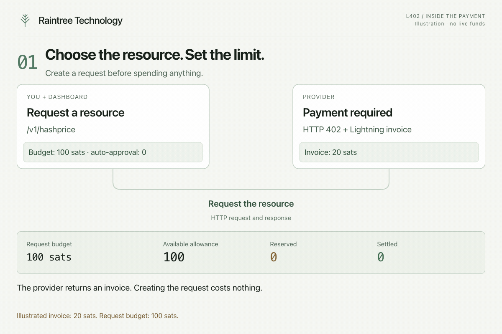
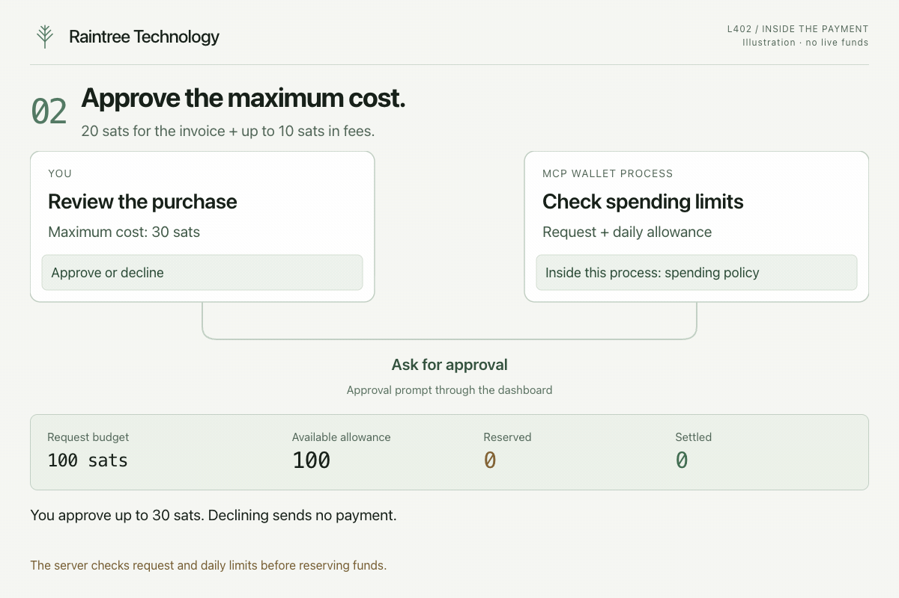
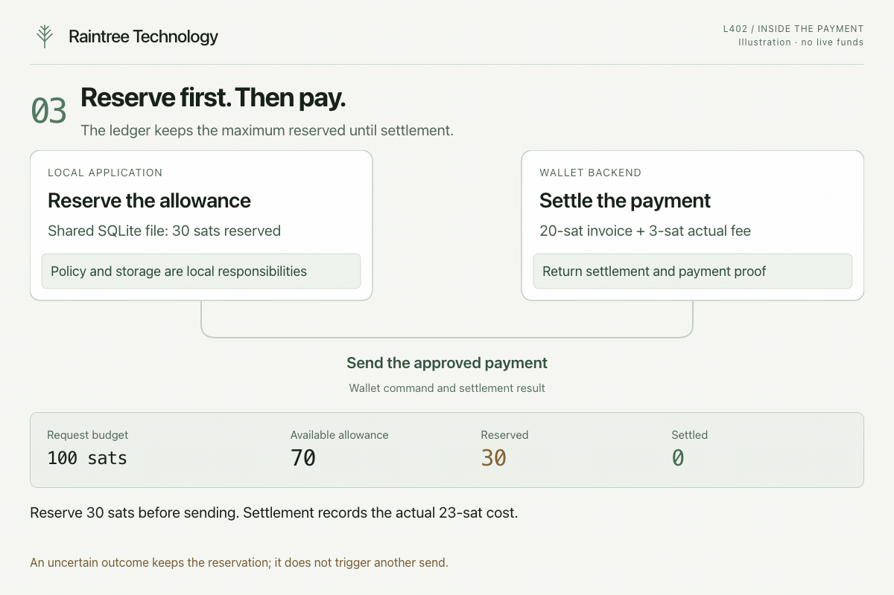
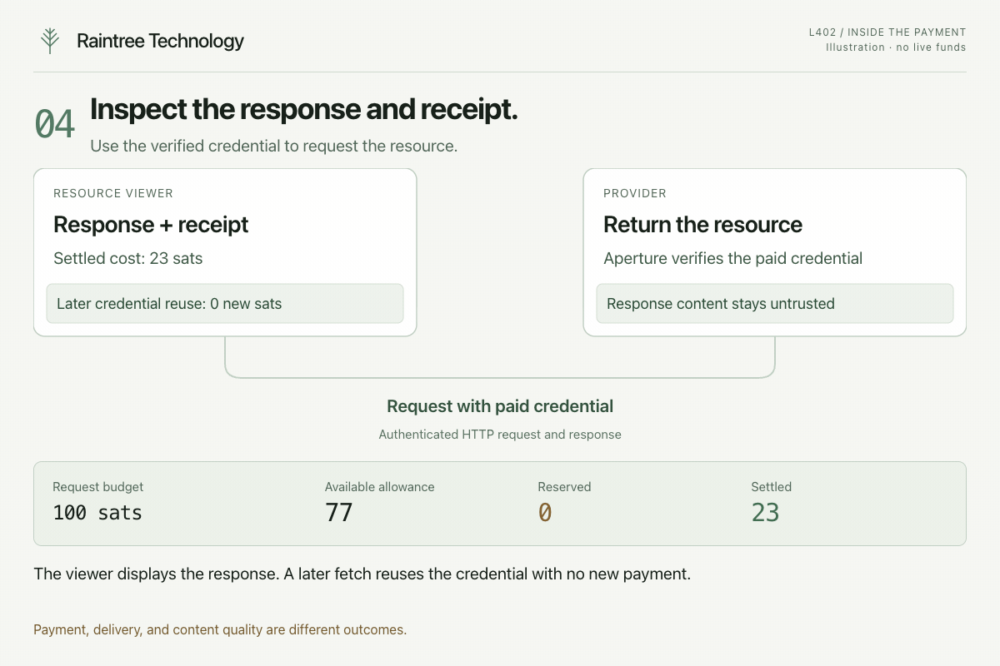

# Controlled L402 resource viewer

Choose a resource, set a spending limit, approve or decline its Lightning invoice, and inspect the response and receipt. The dashboard uses an MCP wallet server and SQLite accounting to track authorization, payment, and delivery.

[Run the demo](#start-the-local-demo) · [Full walkthrough](docs/README.md) · [Configuration](docs/reference.md) · [Verification results](VERIFICATION.md)

## How a purchase works

This illustrated purchase costs 20 sats plus a 3-sat actual fee, with a 10-sat maximum fee authorized before payment. No funds move in the animations.

### 1. Request a resource

Choose a resource and spending limits; the server obtains a payment quote before spending anything.



### 2. Approve the maximum cost

With automatic approval at zero, review and approve up to 30 sats, including the maximum fee.



### 3. Reserve, pay, and verify

Reserve 30 sats before sending, then record the actual 23-sat charge and verified credential after settlement.



### 4. Inspect and reuse

Inspect the response and receipt; later requests can reuse the credential without another payment.



Follow the [12-step walkthrough](docs/README.md) for the implementation, recovery paths, and still-image alternatives. Each overview clip plays once for five seconds and may finish before you scroll to it.

## Start the local demo

Requires Bun and Go 1.26+ to build the pinned binaries. Existing source checkouts must be clean and at their pinned tags.

```sh
bun install --frozen-lockfile
bun run build:binaries  # Skip if the pinned binaries are already installed.
bun run demo
```

Open **http://127.0.0.1:8787**. The demo uses an isolated Bitcoin regtest network and test coins.

1. Enter `/v1/hashprice`, set a budget, and leave auto-approval at zero to review payment.
2. Select **Create request**, then **Start request**.
3. Approve or decline the payment, then inspect the response and receipt.

Ctrl-C stops the network. State and logs remain in the printed temporary directory. See [demo behavior and fixture prices](docs/reference.md#local-demo-behavior) for details.

This is a trusted local application. Payment does not guarantee delivery or useful content; see [payment boundaries](docs/reference.md#payment-controls-and-boundaries).

## Documentation

- [Animated walkthrough](docs/README.md): all 12 steps, accounting, and recovery paths.
- [Configuration and operations](docs/reference.md): existing networks, wallet setup, MCP tools, and stored state.
- [Run the checks](docs/reference.md#verify): unit, browser, and local Lightning checks.
- [Verification results and limitations](VERIFICATION.md): observed results and unverified behavior.
- [Subscriptions](docs/subscriptions.md): 30-day credentials, standing approvals, renewal rules, and litd account backstops.
