# Raintree Technology · Inside an L402 purchase

Follow one purchase from request creation to credential reuse. Each step includes an animation, its outcome, and links to the implementation.

**Example:** a 100-sat request budget, a 20-sat invoice, a 10-sat maximum fee, and a 3-sat actual fee. Automatic approval is zero. These are illustrations, not recordings of live payments. The 20-sat invoice comes from the contract-test scenario; the bundled regtest seller charges 10 sats for hashprice.

Each eight-second clip plays once. Use its still-image link to read without motion. GIFs have no inline playback controls and may finish before you scroll to them.

[Back to the project overview](../README.md#how-a-purchase-works)

## Sequence map

| Stage | Steps | Request allowance |
|---|---|---|
| Request and quote | [1. Create](#1-create-the-request) → [2. Bind](#2-bind-the-mcp-process) → [3. Discover](#3-discover-the-service) → [4. Challenge](#4-receive-the-payment-challenge) → [5. Quote](#5-quote-the-invoice) | 100 available; nothing reserved or settled |
| Authorization | [6. Approve](#6-approve-the-maximum-cost) | Approval alone moves no funds |
| Payment and recovery | [7. Reserve](#7-reserve-the-allowance) → [8. Pay](#8-submit-the-payment) → [10. Verify](#10-verify-proof-and-record-settlement); [9. Reconcile](#9-reconcile-an-uncertain-outcome) if uncertain | Reserve 30; replace it with the actual 23-sat charge |
| Delivery | [11. Deliver](#11-deliver-the-resource) → [12. Reuse](#12-reuse-the-paid-credential) | 77 available; 23 settled; no new payment for reuse |

The sequence shows a new paid purchase. These branches skip parts of it:

- A free resource needs no quote, approval, or payment.
- A saved paid credential goes straight to delivery after reconciliation.
- A successful wallet response goes from step 8 to step 10. Step 9 covers an uncertain outcome.

## What each layer owns

| Layer | Responsibility | Interface |
|---|---|---|
| Browser | Collect limits and human decisions; display the response | Same-origin HTTP to the dashboard |
| Dashboard | Save requests, manage approvals, launch a process for each run | MCP over stdio; local SQLite access |
| MCP wallet server | Discover, quote, apply policy, pay, reconcile, and fetch | HTTP to the provider; wallet adapter calls |
| Spending policy | Decide whether to pay, ask, or refuse | Functions inside the MCP process |
| SQLite store | Commit reservations, receipts, and credentials | Shared local file, accessed through transactions |
| Wallet backend | Submit payments and report their outcomes | lnd through `lncli`; Wavelength through HTTP RPC |
| Aperture and provider | Verify credentials and serve the resource | HTTP challenge and authenticated response |

A **macaroon** is the provider’s access token. The invoice supplies a **payment hash**; the wallet may reveal its matching **preimage** after settlement. The store verifies that match and combines the macaroon and preimage into the **paid credential**. These credentials stay out of the dashboard’s payment records.

## Read the allowance correctly

The diagrams track the request’s accounting allowance, **not its wallet balance**. Reserving funds records a commitment in SQLite; it does not move or lock coins in the wallet.

| Point in this example | Available allowance | Reserved | Settled |
|---|---:|---:|---:|
| Created, quoted, or approved | 100 | 0 | 0 |
| Reservation committed; outcome unresolved | 70 | 30 | 0 |
| Settled at 20 + 3 sats | 77 | 0 | 23 |
| Credential reused | 77 | 0 | 23 |

All values are sats. The 7-sat difference is released allowance, not a refund. Request charges persist across days. The shared daily limit counts paid receipts dated today in UTC plus unresolved reservations from every day. A valid approval cannot override either limit.

## 1. Create the request

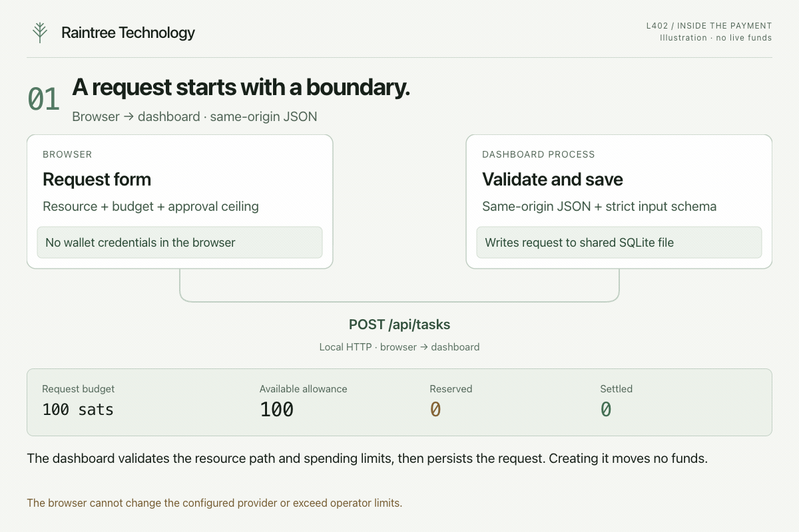

[View this step without motion](assets/payment-step-01.png)

The browser submits a resource path, request budget, and automatic-approval ceiling. The dashboard accepts only same-origin JSON, validates the path, and checks that the requested limits do not exceed operator policy. It saves the request in SQLite with status `ready`.

**Result:** the request exists, but no invoice has been paid. The browser cannot choose a different provider through this form.

**Code:** [request validation](../agent/request.ts), [dashboard HTTP handlers](../dashboard/server.ts).

## 2. Bind the MCP process

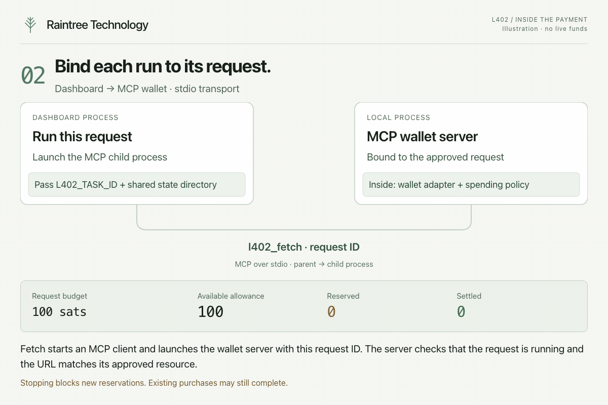

[View this step without motion](assets/payment-step-02.png)

Selecting **Start request** starts an MCP client and child wallet-server process for that run. Resuming starts another process bound to the same request. The runner passes `L402_TASK_ID` and the shared state directory, then calls `l402_fetch` over stdio. The server checks that the request is running and the URL matches its approved resource.

**Result:** this MCP fetch is bound to the saved request. Stopping the request prevents new reservations. A purchase already reserved or submitted may still complete.

**Code:** [request runner](../dashboard/runner.ts), [request checks in Store](../agent/store.ts).

## 3. Discover the service

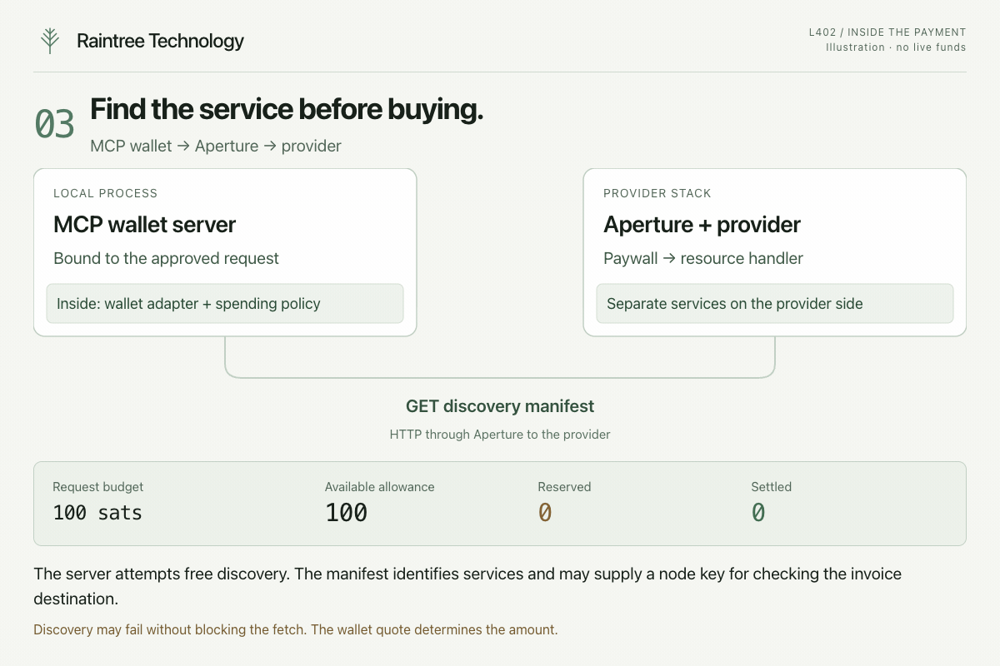

[View this step without motion](assets/payment-step-03.png)

The MCP server attempts to read `/.well-known/l402.json`. The manifest describes services, resource paths, and advertised prices. When it includes a provider node key and the wallet quote includes a destination, the server compares them before paying.

**Result:** discovery supplies service context. The wallet quote determines the invoice amount. A failed discovery attempt does not by itself prevent the resource fetch.

**Code:** [manifest validation and discovery](../agent/server.ts).

## 4. Receive the payment challenge

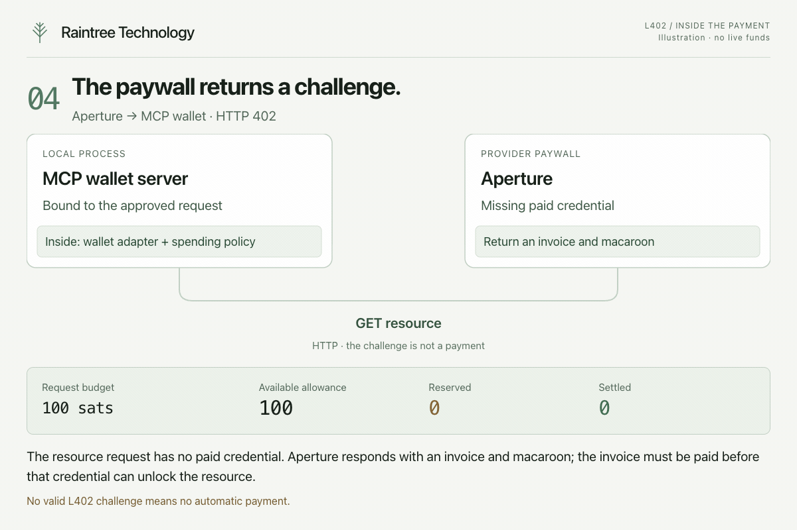

[View this step without motion](assets/payment-step-04.png)

Without a reusable credential or recorded purchase blocking a new payment, the server requests the resource. Aperture returns HTTP 402 with an L402 challenge containing a Lightning invoice and macaroon.

**Result:** the server has a payment challenge, not proof of payment. A 402 without a valid challenge does not trigger payment. A response that does not require payment is returned directly.

**Code:** [resource fetch](../agent/server.ts), [challenge parser](../agent/policy.ts).

## 5. Quote the invoice

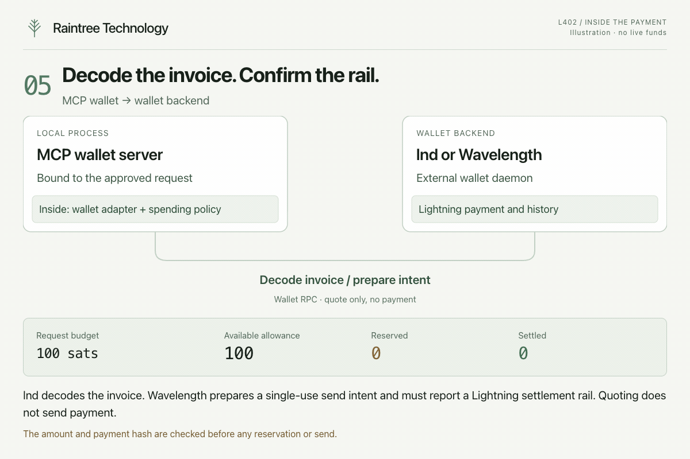

[View this step without motion](assets/payment-step-05.png)

The lnd backend decodes the invoice. The Wavelength backend prepares a single-use send intent and requires a Lightning settlement rail. The server validates the payment hash; spending-policy checks reject invalid amounts.

**Result:** this example has a 20-sat invoice and a maximum routing fee of 10 sats. Quoting does not submit payment.

**Code:** [wallet quote methods](../agent/wallet.ts), [spending validation](../agent/policy.ts).

## 6. Approve the maximum cost

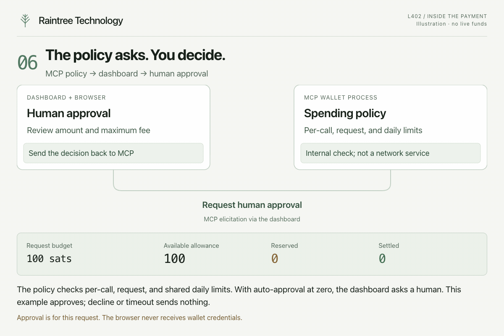

[View this step without motion](assets/payment-step-06.png)

The policy checks the per-call cap, request allowance, and shared daily allowance. Since automatic approval is zero, it asks for human approval through MCP elicitation. The dashboard displays the invoice amount and maximum fee.

**Result:** approving authorizes up to 30 sats for this purchase. Decline, timeout, or unavailable approval sends no payment. Approval does not reserve funds; the transaction in the next step rechecks the limits.

**Code:** [policy decisions](../agent/policy.ts), [approval lifecycle](../dashboard/runner.ts), [MCP elicitation](../agent/server.ts).

## 7. Reserve the allowance

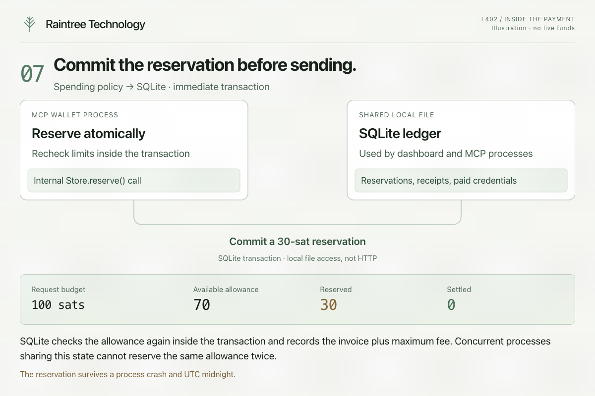

[View this step without motion](assets/payment-step-07.png)

`Store.reserve()` opens an immediate SQLite transaction. It checks for a previous purchase, verifies the request and approval, and rechecks the shared budget. It records the invoice plus maximum fee before the server calls the wallet. Human approval can still be refused here if another process has used the remaining allowance.

**Result:** 30 sats are reserved and 70 remain available. Processes sharing this state cannot reserve the same allowance twice. An unresolved reservation survives process restart and UTC midnight.

**Code:** [reservation transaction](../agent/store.ts), [accounting and concurrency tests](../agent/store.test.ts).

## 8. Submit the payment

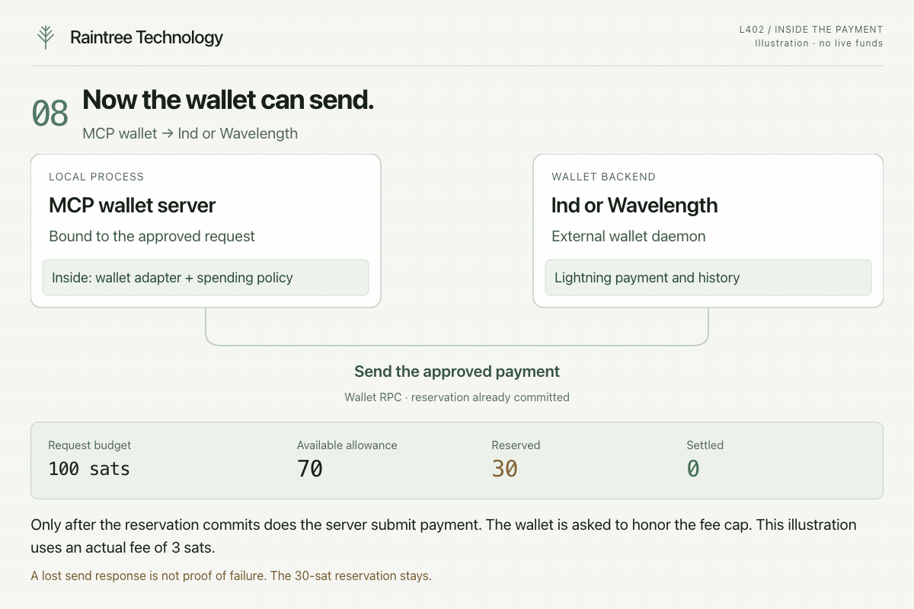

[View this step without motion](assets/payment-step-08.png)

The MCP server asks the wallet to pay. lnd receives a fee limit; Wavelength consumes the prepared send intent. Wavelength’s send RPC can return before settlement; its adapter polls history. A timeout or transport failure leaves the application without a definitive outcome.

**Result:** the reservation remains until wallet evidence establishes an outcome. A lost response does not establish failure. Fee-limit enforcement depends on the wallet honoring its authorization.

**Code:** [wallet payment methods](../agent/wallet.ts), [send and error handling](../agent/server.ts).

## 9. Reconcile an uncertain outcome

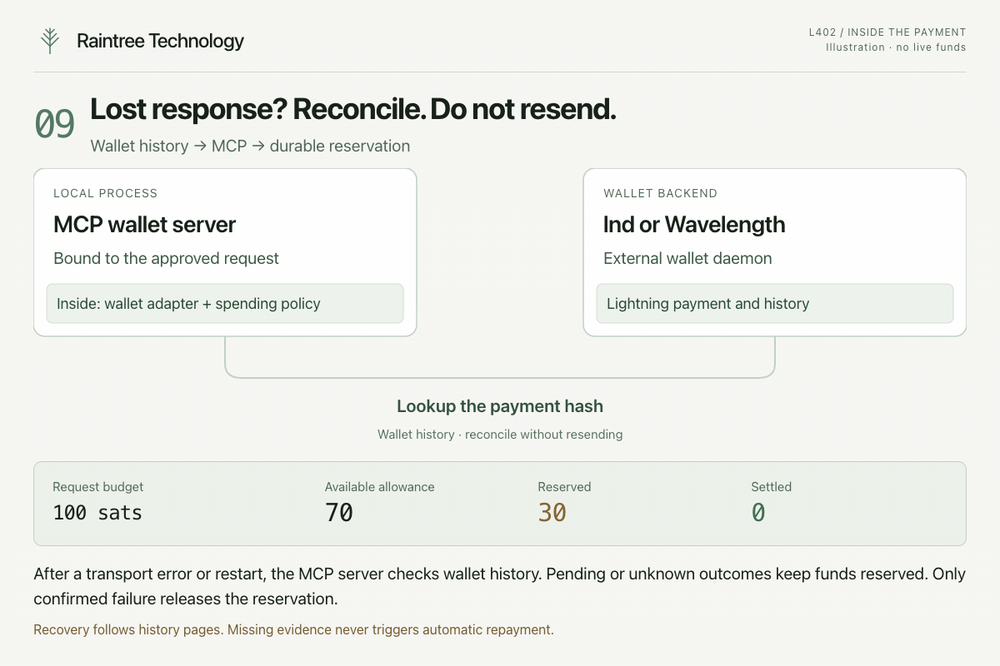

[View this step without motion](assets/payment-step-09.png)

This is the recovery branch after a transport error or restart. The server queries wallet history by payment hash, following pagination. A pending or unknown outcome retains the reservation. Confirmed failure releases it; confirmed settlement proceeds to recording the charge and verifying proof.

**Result:** uncertainty does not cause an automatic resend. The illustrated wallet reports settlement, so the next step can finish the ledger update. A normal successful payment can proceed directly from step 8 to step 10.

**Code:** [reconciliation](../agent/server.ts), [wallet history lookup](../agent/wallet.ts), [process recovery tests](../agent/server.test.ts).

## 10. Verify proof and record settlement

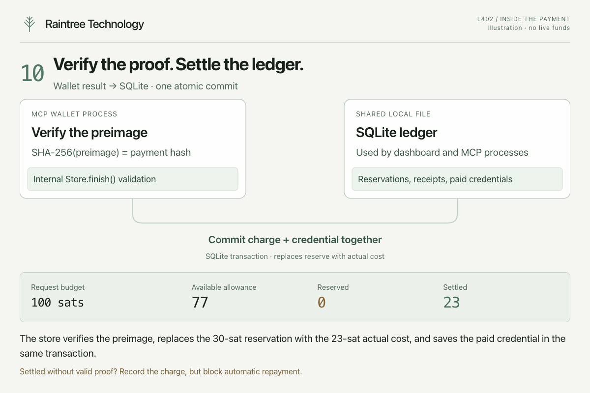

[View this step without motion](assets/payment-step-10.png)

`Store.finish()` validates the settlement fee and checks that `SHA-256(preimage)` matches the payment hash. With valid proof, it saves the paid credential and updates the receipt in the same SQLite transaction.

**Result:** the 30-sat reservation becomes a 23-sat charge, leaving 77 sats available. Settlement without valid proof still records the charge, but creates no usable credential and blocks automatic repayment. Later valid proof can repair access without charging the settlement again. If the wallet reports a fee above the authorized limit, the store records that actual fee and flags the violation; it cannot undo the wallet’s payment.

**Code:** [settlement transaction and proof validation](../agent/store.ts), [atomicity and late-proof tests](../agent/store.test.ts).

## 11. Deliver the resource

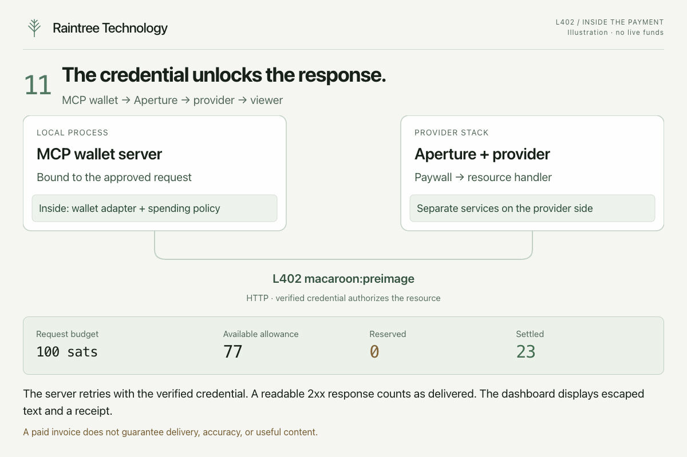

[View this step without motion](assets/payment-step-11.png)

The server requests the resource with `L402 macaroon:preimage`. Aperture verifies the credential and permits access to the provider. The dashboard retains the response and displays it as escaped text. Response bodies are limited to 64 KiB.

**Result:** the dashboard marks delivery received only for a 2xx response whose body was read within the limit. It does not establish accuracy or usefulness. If delivery fails, the payment remains recorded and automatic repayment stays blocked.

**Code:** [authenticated delivery and response limits](../agent/server.ts), [delivery state](../dashboard/runner.ts), [response rendering](../web/app.js).

## 12. Reuse the paid credential

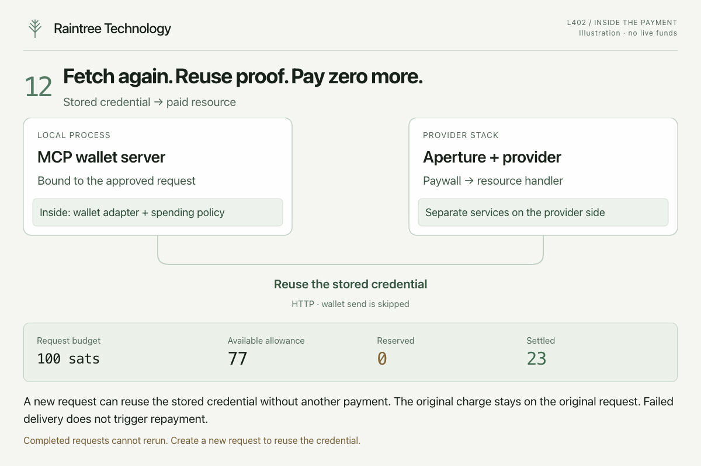

[View this step without motion](assets/payment-step-12.png)

A completed dashboard request cannot run again. Create a new request for the same resource to fetch it again. The server looks up credentials by provider origin and discovered service name, falling back to the resource pathname when no service matches. The server reconciles existing purchases and checks its credential store before preparing a new payment. Reuse returns a response without another wallet send.

**Result:** the original request keeps its 23-sat charge. A new request that reuses the credential records zero additional payment; it does not inherit the original charge. A rejected credential blocks automatic repurchase. Authorization, payment, and delivery remain separate outcomes.

**Code:** [credential reuse](../agent/server.ts), [dashboard reuse tests](../dashboard/requests.test.ts).

## When the sequence stops

| Outcome | Accounting effect | What resuming does |
|---|---|---|
| Refused or human declined | No new reservation or wallet send | Starts another attempt; checks limits and requests approval when needed |
| Payment pending or unknown | Keeps the full reservation | Looks for wallet evidence; does not resend automatically |
| Wallet confirms failure | Releases the reservation | May attempt a new purchase; the same payment hash remains blocked |
| Settled without valid proof | Records the charge; saves no usable credential | Looks for late proof; does not repay automatically |
| Paid, but response fails or exceeds 64 KiB | Keeps the charge and credential | Retries delivery with that credential |
| Dashboard restarts during approval | Expires the approval; marks the request interrupted | Requires a fresh approval if the purchase still needs one |
| Request stopped | Existing reservations and charges remain | Reconciles when resumed; stopping is not payment cancellation |

These rules require processes to share the same state directory. Separate directories do not coordinate allowances. The wallet must honor its fee cap and report truthful outcomes; SQLite cannot enforce the wallet’s actual outflow.

## Run it and check the evidence

Return to [Start the local demo](../README.md#start-the-local-demo) to try the workflow with regtest coins. Use the [configuration and operations reference](reference.md) for wallet setup, recovery, stored state, and check commands. See [verification results and limits](../VERIFICATION.md) for observed results and the remaining live-wallet checks.

## Regenerate the illustrations

The [still overview](assets/payment-flow.png) and [combined 20-second animation](assets/payment-flow.gif) summarize the four stages. The [HTML source](payment-flow.html) defines the scenes. The [render script](../scripts/render-payment-flow.ts) exports the overview clips, 12 step animations, and still images into `docs/assets/`.

Use an existing Playwright installation, Chrome, and FFmpeg. From the repository root, run:

```sh
PLAYWRIGHT_MODULE=/absolute/path/to/node_modules/playwright bun scripts/render-payment-flow.ts
```

Omit `PLAYWRIGHT_MODULE` if Playwright resolves normally. Set `PLAYWRIGHT_CHANNEL` to use another installed browser channel. The script checks playback, chapter navigation, reduced motion, keyboard controls, accounting totals, text fit, and mobile overflow before finishing the exports.
