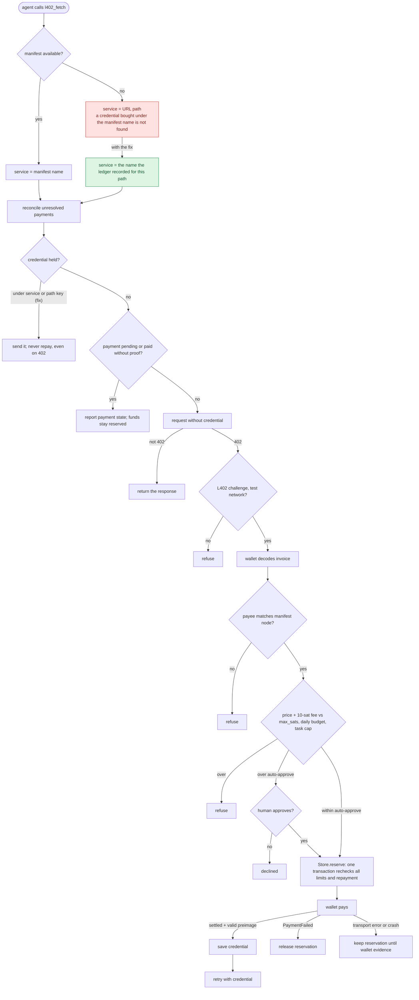
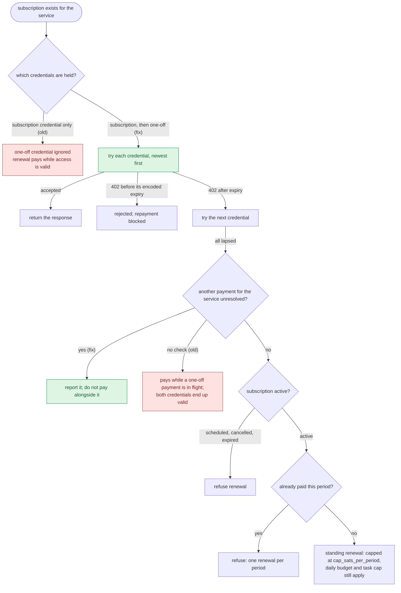
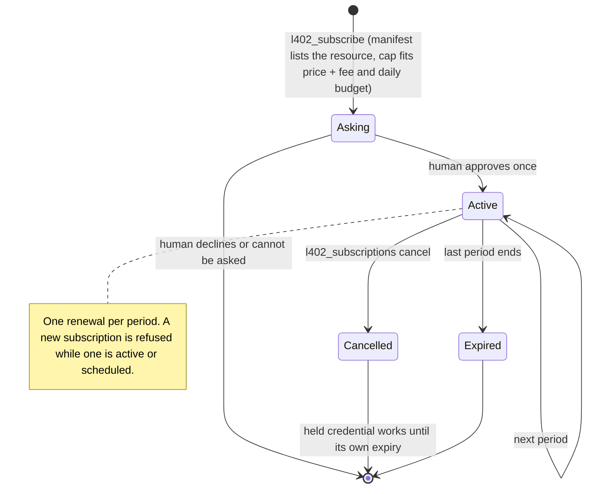
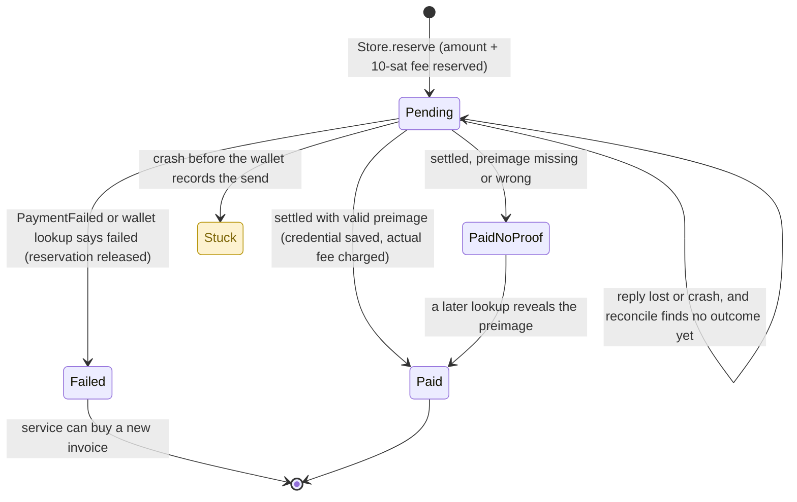
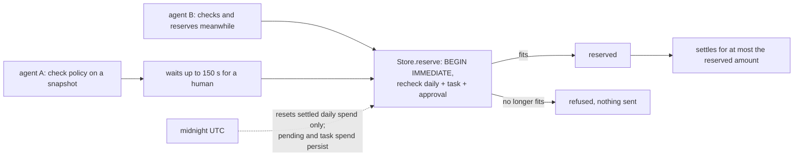

# Statecharts and model checking

These charts show what the MCP server does for each tool, from the agent's call to the outcome. They were drawn from [`agent/server.ts`](../agent/server.ts) and [`agent/store.ts`](../agent/store.ts). The models in [`models/`](../models) then explored every interleaving of the flows within small bounds. Colors:

- **Grey**: works, and the models found no violation.
- **Red**: a bug the model checker found. Each one is now fixed.
- **Green**: the fix.
- **Amber**: a known, documented trade-off.

`bun test models` explores each model to exhaustion. Tests that turn each fix back off check that the checker still finds the counterexample.

## l402_fetch: one-off purchase

The model found the red path in three steps: buy `/data`, take the manifest down, then fetch `/data` again. The service key changed from `data` to `/data`, so the server paid a second time while holding a credential the provider accepted. The reverse order did the same, because a credential bought during an outage was stored under the path. With the fix, the server looks the service name up in the ledger, both keys are checked, and `Store.reserve` blocks a repayment under either name.

## l402_fetch: with a subscription

Two traces led here. In the first, the agent buys the resource once, subscribes, and fetches again: the old code checked only subscription credentials, so it paid for a renewal immediately, and refused after cancellation even though the one-off credential still worked. The second appeared only after fixing the first two bugs. A one-off payment is pending when the agent subscribes, and the subscription pays for period 0. The pending payment then settles, so the agent holds a valid one-off credential. In period 1, the expired subscription credential is tried first, and the server renews while the one-off credential still works. The fix tries every held credential and refuses to pay while any payment for the service is unresolved.

## l402_subscribe and l402_subscriptions

## Payment settlement

The checker confirms that a failed row never hides a settled payment, and that the service is paid for at most once. Its liveness check reports one known trace (amber): if the process dies before the wallet records the send, the wallet can never report an outcome, so the reservation stays forever. The README documents this trade-off: keeping the funds reserved is safer than guessing that no payment happened. Turning off "release only on wallet evidence" produces a double payment within seven steps.

## Budgets across agents

With two agents, human approval, settlement fees from 0 to 10 sats, and midnight, the model found no way to exceed the daily budget, exceed the task cap, or pay above auto-approval without a human. Without the recheck in `Store.reserve`, a stale snapshot overspends in five steps.

## Read-only tools

- `l402_discover` fetches the manifest and caches it for later fetches.
- `l402_preview` uses the same service resolution and held-credential lookup as `l402_fetch`, never calls resources or the wallet, and reserves nothing.
- `l402_task` and `l402_wallet` reconcile unresolved payments, then report from the ledger.

## Not modeled

- The provider rejecting a credential early. The server blocks repayment in that case, and tests cover it.
- Disk or power loss. Process crashes are modeled.
- A manifest that renames a service between purchases. The ledger lookup covers outages, not renames.
- The payee-node check while discovery is down. Without a manifest, there is no node to compare against.
